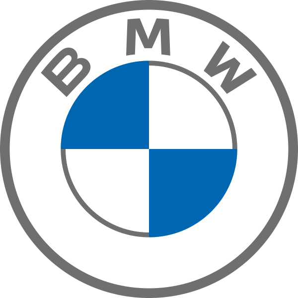
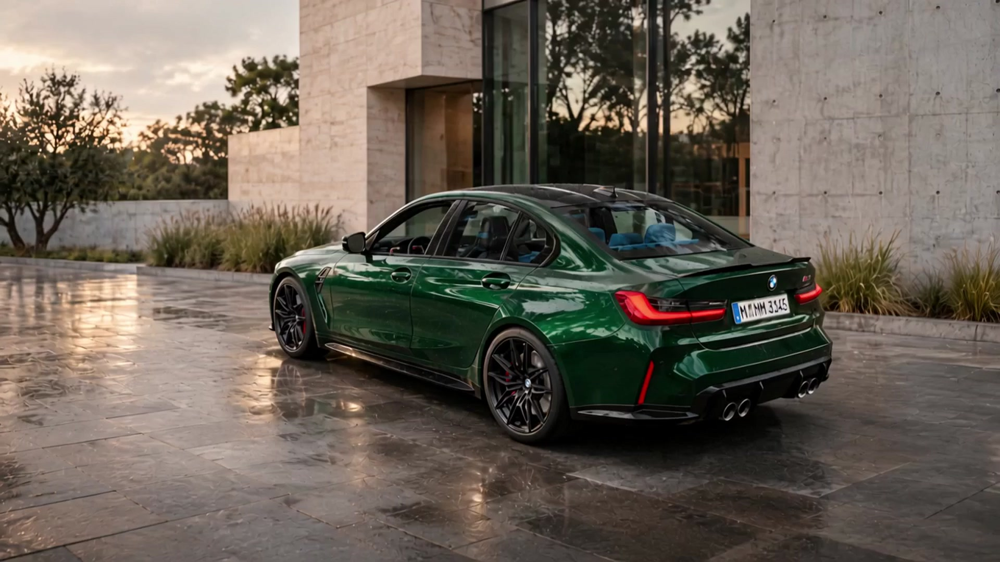
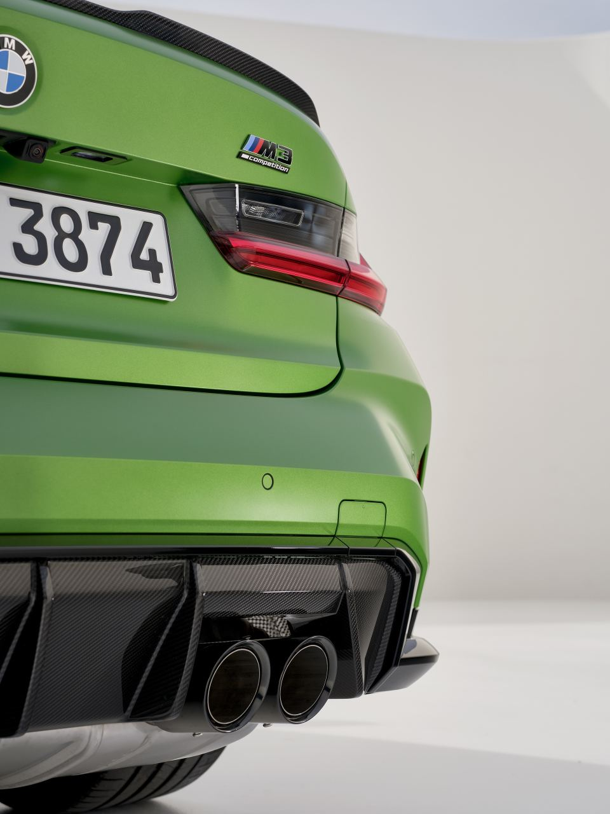
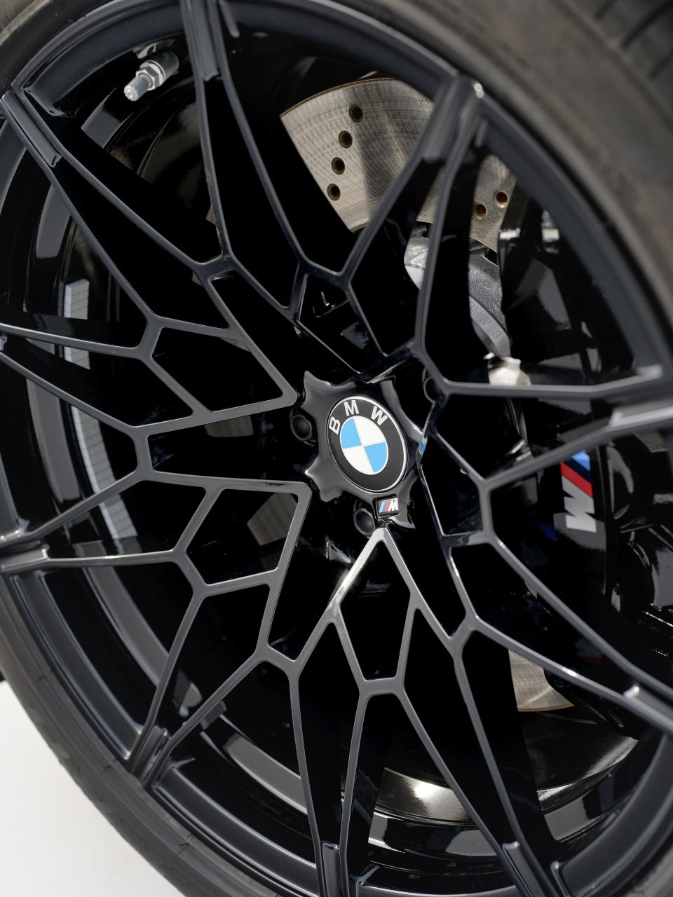
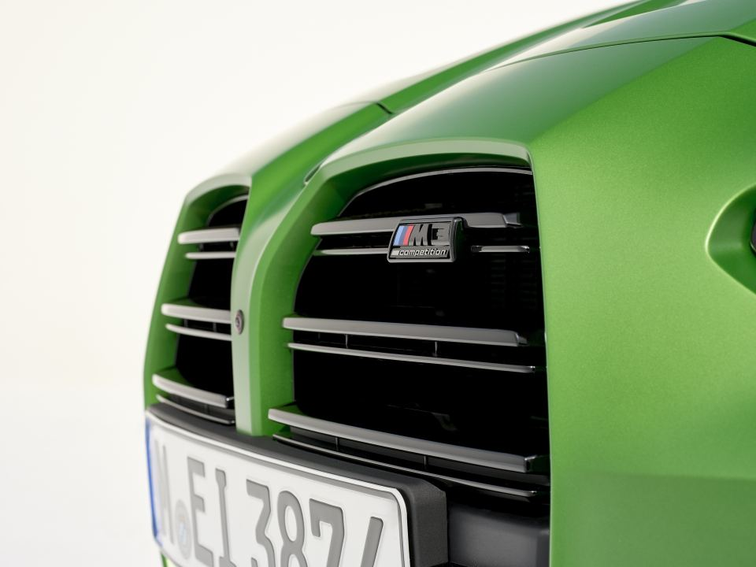
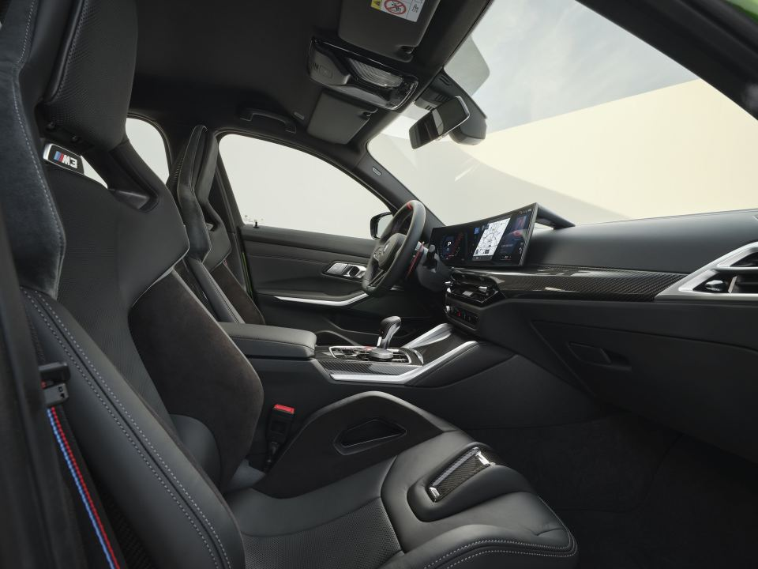
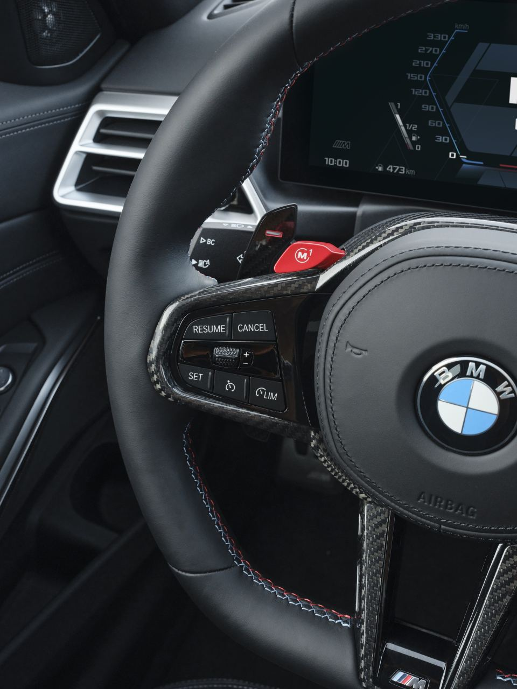
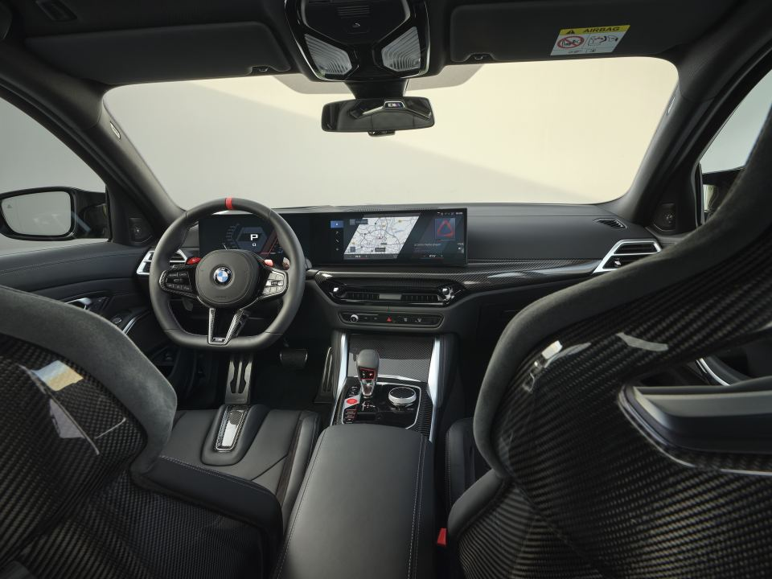

<div align="center">



# BMW M3 Competition — Por dentro e por fora

**Um passeio em vídeo guiado pela rolagem.** Você desce a página e o carro gira, abre a porta e mostra o que tem de melhor, peça por peça.

[**Ver o site ao vivo →**](https://gabrielnovaesdev.github.io/BMW-Landingpage/)

<br>



</div>

<br>

## O passeio

A primeira parte da página é um filme de 15 segundos preso na tela. A rolagem controla o tempo do vídeo, e cada peça ganha um ponto que segue o carro, uma linha fina e um cartão com o que importa e os números oficiais.

<table>
  <tr>
    <td width="33%"><br><sub><b>01 · Lanternas</b><br>Olha essa assinatura</sub></td>
    <td width="33%"><br><sub><b>02 · Rodas e freios</b><br>Para parar tão bem quanto anda</sub></td>
    <td width="33%"><br><sub><b>03 · Faróis</b><br>Cara de poucos amigos</sub></td>
  </tr>
  <tr>
    <td><br><sub><b>04 · Bancos e acabamento</b><br>Sentou, encaixou</sub></td>
    <td><br><sub><b>05 · Volante</b><br>Tudo na sua mão</sub></td>
    <td><br><sub><b>06 · Multimídia</b><br>Uma tela só, do painel ao centro</sub></td>
  </tr>
</table>

## O que tem na página

| | |
|---|---|
| **Entrada** | O logotipo e o nome entram do desfoque, letra por letra. Uma linha fina enche com o carregamento real do vídeo, atravessa a tela e se abre como uma fenda até o filme. |
| **Passeio** | Vídeo preso na tela e controlado pela rolagem, com seis pontos de interesse que acompanham o carro quadro a quadro, trilho de capítulos e barra de progresso. |
| **Saída do passeio** | A câmera recua e o último quadro do filme vira o centro de um mosaico de fotos oficiais, que chegam de fora da tela. |
| **Manifesto** | Um parágrafo que acende palavra por palavra, com fotos que se abrem entre as palavras. |
| **Desenho** | A foto começa numa janela pequena e a câmera se aproxima até ela ocupar a tela, revelando as medidas. |
| **Engenharia M** | Foto presa na tela que troca em cortina, com contador, conforme os quatro itens passam: M xDrive, freios M Compound, suspensão M adaptativa e diferencial M ativo. |
| **Galeria** | Túnel em profundidade: as fotos vêm do fundo em direção à câmera, com legenda que acompanha. |
| **Cabine** | A página clareia ao entrar e as fotos do interior andam em velocidades diferentes. |
| **Versões** | Tabela comparando M3, M3 Competition e M3 Competition M xDrive, com barras de aceleração. |
| **Ficha técnica** | Seis abas (motor, desempenho, transmissão e tração, chassi, dimensões e pesos, interior e tecnologia), navegáveis pelo teclado. |
| **Encerramento** | A foto final abre pela mesma fenda da entrada. |

## Como funciona

**Vídeo que responde à rolagem sem travar.** O filme foi reamostrado para 60 quadros por segundo com interpolação de movimento e codificado em H.264 *all-intra* (todo quadro é um quadro-chave). Assim o navegador decodifica qualquer quadro sozinho, nos dois sentidos, sem precisar voltar ao quadro-chave anterior.

**Busca guiada por eventos.** O script só pede o próximo quadro quando o anterior termina de carregar (`seeked`), e o tempo mostrado segue a rolagem com amortecimento. Nada de fila de buscas acumuladas.

**Tempo que desacelera nos cartões.** Uma função de mapeamento converte o tempo do vídeo em distância de rolagem e estica os trechos com cartão, para dar tempo de ler. O passeio inteiro cabe em cerca de 7 telas.

**Cada seção com um movimento próprio.** As animações de rolagem foram pensadas a partir de onze sites da categoria de rolagem do Awwwards (entre eles Burgundy, Serein, Estheet, Konk, Santal e Openstate): recuo de câmera, foto dentro do texto, aproximação, cortina, túnel em profundidade e inversão de cor. Tudo anima só `transform`, `opacity` e `clip-path`.

**Pontos presos ao carro.** Cada peça tem uma trilha de posições medida sobre os quadros do vídeo. O ponto, a linha e o cartão são recalculados a cada quadro, inclusive no celular, onde o vídeo ocupa uma faixa e se desloca lateralmente para manter a peça à vista.

## Tecnologia

- HTML, CSS e JavaScript puros, sem etapa de build
- [GSAP 3.13](https://gsap.com/) com ScrollTrigger e ScrollSmoother, incluídos em `js/vendor`
- Fonte [Archivo](https://fonts.google.com/specimen/Archivo) com eixo de largura
- Responsivo do celular ao desktop, com `prefers-reduced-motion` respeitado

```
├── index.html
├── css/style.css
├── js/
│   ├── main.js          # entrada, passeio, pontos, cartões e seções
│   └── vendor/          # GSAP, ScrollTrigger, ScrollSmoother
├── assets/
│   ├── m3-60.mp4        # filme 1080p, 60 fps, all-intra
│   ├── poster.jpg
│   ├── last-frame.jpg   # último quadro, usado no recuo da câmera
│   ├── photos/          # fotos oficiais da BMW (1920 px e 960 px)
│   └── brand/           # logotipo BMW
└── serve.py             # servidor local com suporte a Range
```

## Rodar localmente

Precisa só de Python 3.

```bash
git clone https://github.com/gabrielnovaesdev/BMW-Landingpage.git
cd BMW-Landingpage
python serve.py
```

O site abre em `http://localhost:5173`. Para usar outra porta, `python serve.py 8080`.

> Use o `serve.py` em vez de `python -m http.server`. O vídeo só consegue pular para qualquer quadro se o servidor responder a pedidos *Range*, e o servidor padrão do Python não faz isso. Abrir o `index.html` direto pelo arquivo também não funciona.

## Dados

Todos os números vêm de fontes oficiais da BMW:

- [BMW Group PressClub, “The new BMW M3 Sedan” (29/05/2024)](https://newsroom.bmwgroup.com/emea/en-ae/the-new-bmw-m3-sedan-en-ae_20260909133622724)
- [Especificações técnicas BMW M3 Sedan (05/2024, PDF)](https://newsroom.bmwgroup.com/emea/download/edf7630b-3b8d-4aa1-8a38-ee22d1cf09eb/20260909133618243-759.pdf)

As fotos das seções são imagens oficiais de imprensa do BMW M3 Sedan, publicadas pela BMW Group na mesma página.

São dados para os mercados europeus, que a própria BMW chama de provisórios. O que não foi confirmado nessas fontes, como o nome da pintura ou o tamanho das telas, ficou de fora.

---

<sub>Fotos: BMW Group. Projeto independente de apresentação, sem vínculo oficial com a BMW. BMW e o logotipo BMW são marcas registradas da BMW AG.</sub>
